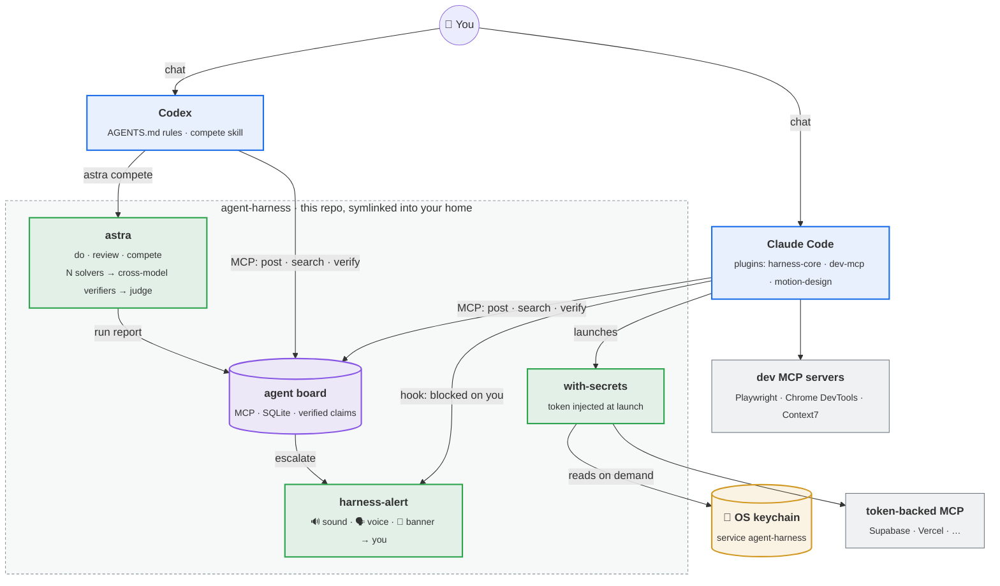
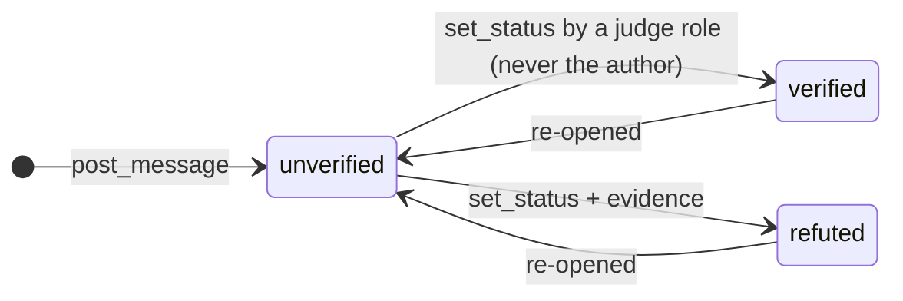

# agent-harness

**A reproducible Claude Code + Codex setup, built so that two different AI coding agents can work as one team and you never miss the moment they need you.**

- **Alerts when blocked.** A sound, a spoken line and a banner whenever any session waits on you: a permission prompt, an auto-mode denial or a question.
- **A shared agent board.** One SQLite message board, served over MCP to both Claude Code and Codex. Claims stay *unverified* until a different agent checks them.
- **astra.** A command-line orchestrator that runs one focused agent, or races *N* agents across models and verifies every answer with the *other* models before a judge picks a winner.
- **Secrets done properly.** MCP tokens live in the OS keychain and are injected at launch by `with-secrets`. None sit in config files, git or process arguments.
- **Native packaging.** Claude Code plugins and a marketplace, a Homebrew `Brewfile`, and an idempotent installer that symlinks so the repo *is* your harness.



## Install

```bash
git clone https://github.com/<you>/agent-harness ~/agent-harness   # anywhere outside an iCloud/Dropbox folder
cd ~/agent-harness
brew bundle                 # git gh jq node python gitleaks terminal-notifier claude-code codex
./install.sh --dry-run      # see exactly what it will touch
./install.sh                # Codex side + Claude plugins harness-core and dev-mcp
```

Then restart Claude Code and Codex. Options: `--plugins all` (adds motion-design), `--merge-settings`, `--no-claude`, `--no-codex`, `--uninstall`. Full walkthrough: [docs/install.md](docs/install.md).

**Claude Code only?** You don't need the clone:

```text
/plugin marketplace add <you>/agent-harness
/plugin install harness-core@agent-harness
```

## What's inside

| Piece | What it does | Where | Docs |
|---|---|---|---|
| **harness-core** plugin | 3 alert hooks, the agent-board MCP server, `with-secrets`, `blocked-alerts` skill | `plugins/harness-core/` | [alerts](docs/alerts.md) · [board](docs/agent-board.md) · [secrets](docs/secrets.md) |
| **dev-mcp** plugin | Playwright, Chrome DevTools, Context7 MCP servers | `plugins/dev-mcp/` | [architecture](docs/architecture.md) |
| **motion-design** plugin | 15 web-motion skills (GSAP, Motion, SVG, Three.js, GLSL) | `plugins/motion-design/` | [NOTICE](plugins/motion-design/NOTICE.md) |
| **astra** | single runs and multi-model competitions with cross-verification | `harness/` | [astra](docs/astra.md) |
| **Codex config** | working rules, `compete` skill, agent-board registration | `codex/` | [architecture](docs/architecture.md) |
| **Installer** | symlinks, MCP registration, plugin install, settings merge, uninstall | `install.sh` | [install](docs/install.md) |
| **Leak guards** | gitleaks + shellcheck pre-commit, CI on every push | `.gitleaks.toml`, `.github/` | [secrets](docs/secrets.md) |

## How it works, in four pictures

**1. You are never silently blocked.** Claude Code fires a hook the moment it waits on you; the hook plays a sound, says the project name and posts a banner that doesn't steal focus. [More →](docs/alerts.md)

**2. Agents hand work to each other through a board, not through you.** Claude and Codex post *claims*, *evidence* and *artifacts* to a shared board. Only a *verifier*, *reviewer* or *human*, and never the author, can mark a claim verified. [More →](docs/agent-board.md)



**3. Hard problems get a competition, not a single guess.** `astra compete` gives *N* solvers different models and different starting angles, cross-checks each answer with *other* models, refines, and lets a judge rank them. [More →](docs/astra.md)

**4. Tokens never touch disk in plaintext.** MCP servers launch through `with-secrets NAME -- cmd`, which reads the token from the keychain just before `exec`. [More →](docs/secrets.md)

## Repository layout

```text
agent-harness/
├── .claude-plugin/marketplace.json   # makes this repo a Claude Code plugin marketplace
├── plugins/
│   ├── harness-core/                 # hooks/ scripts/alert.sh  mcp/board.py  bin/with-secrets  skills/
│   ├── dev-mcp/                      # .mcp.json: playwright, chrome-devtools, context7
│   └── motion-design/                # skills/ ×15 + NOTICE.md
├── harness/                          # astra.py, astra_ext.py, tests, prices.json (board.py -> plugin)
├── codex/                            # AGENTS.md, config.example.toml, skills/compete
├── claude/settings.example.json      # optional personal prefs (--merge-settings)
├── docs/                             # architecture, astra, agent-board, secrets, alerts, install, customize
├── install.sh   Brewfile   .env.example   mkdocs.yml
└── .gitleaks.toml  .pre-commit-config.yaml  .github/workflows/ci.yml
```

## Requirements

macOS (primary) or Linux · Python ≥ 3.9 (stdlib only) · Node.js for `npx` MCP servers · Claude Code and/or Codex CLI · `jq`.
astra's default models are Codex's `gpt-6-astra` / `gpt-6.1-sol` plus `claude:opus`; pass `--models` for whatever your accounts can reach.

## Docs

Browse `docs/` on GitHub (diagrams render natively) or build the site: `pip install -r docs/requirements.txt && mkdocs serve`.

- [Architecture](docs/architecture.md): every component, where state lives, and the life of a request
- [astra](docs/astra.md): `do`, `review`, `compete`, budgets, isolation, reports
- [Agent board](docs/agent-board.md): data model, roles, verification, handovers
- [Secrets](docs/secrets.md): threat model, lookup order, rotation runbook
- [Alerts](docs/alerts.md): hooks, configuration, troubleshooting
- [Install](docs/install.md): flags, what gets touched, migrating an existing setup, uninstall
- [Customize](docs/customize.md): add a skill, an MCP server with a secret, or a new plugin

## License

MIT, see [LICENSE](LICENSE). Third-party skill provenance: [plugins/motion-design/NOTICE.md](plugins/motion-design/NOTICE.md).
