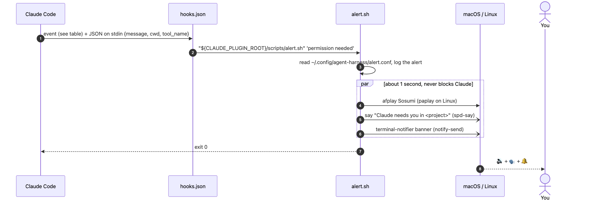

# Alerts

Long agent runs fail quietly in one specific way: the agent stops to ask permission while you are in another window, and
nothing happens for an hour. The harness-core plugin makes that impossible to miss.

<picture>
  <source media="(prefers-color-scheme: dark)" srcset="diagrams/alert-flow-dark.png">
  
</picture>

<sub>Diagram source: <a href="diagrams/alert-flow.mmd"><code>alert-flow.mmd</code></a></sub>

| Hook event | Matcher | Fires when | Banner |
|---|---|---|---|
| `Notification` | `permission_prompt\|elicitation_dialog` | a permission prompt or input dialog is waiting | Claude: permission needed |
| `PermissionDenied` | (all) | auto mode's classifier blocked a step | Claude: auto mode blocked a step |
| `PreToolUse` | `AskUserQuestion` | Claude asks you a question | Claude: question for you |
| board `escalate` | (via `BOARD_ALERT`) | an agent says a human must act | Claude: board escalation |

## Configure

`~/.config/agent-harness/alert.conf` is re-read on every alert, so no restart is needed:

```bash
ENABLED=1   # 0 mutes everything
SOUND=1
VOICE=1     # spoken "Claude needs you in <project>"
NOTIFY=1    # banner; doesn't steal focus
POPUP=0     # macOS dialog that DOES steal focus; off by default
```

Or just ask Claude: *"mute my alerts"*, *"no voice"*, *"test my blocked alerts"*. The `blocked-alerts` skill knows the file.

## Troubleshooting

| Symptom | Check |
|---|---|
| Nothing at all | `tail ~/Library/Logs/claude-alert.log`. No new line means the hook didn't fire: is harness-core enabled (`/plugin`)? Does `/hooks` list it? |
| Logged but silent | `alert.conf`, volume and mute, Focus mode |
| Sound but no banner (macOS) | System Settings → Notifications → allow **terminal-notifier**; `brew install terminal-notifier` |
| Alerts fire twice | an older copy of the hooks in `~/.claude/settings.json`; remove those, since the plugin provides them |
