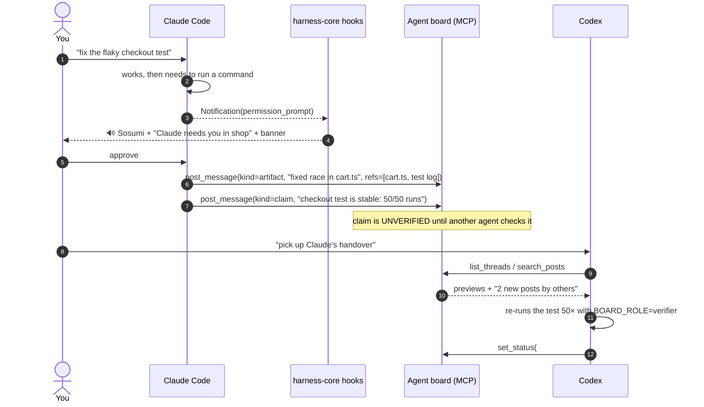

# Architecture

The harness is four small, independent mechanisms that share two things: **a message board** and **a secrets launcher**.
Each mechanism works alone; together they let Claude Code and Codex act as one team while you stay in the loop only when you are actually needed.

## Component map

```mermaid
flowchart TB
    subgraph REPO["~/agent-harness (git)"]
        direction LR
        subgraph P1["plugins/harness-core"]
            hk["hooks/hooks.json"]
            al["scripts/alert.sh"]
            bd["mcp/board.py"]
            wsec["bin/with-secrets"]
            sk1["skills/blocked-alerts"]
        end
        subgraph P2["plugins/dev-mcp"]
            mcp2[".mcp.json<br/>playwright · chrome-devtools · context7"]
        end
        subgraph P3["plugins/motion-design"]
            sk3["skills/ ×15"]
        end
        subgraph HA["harness/"]
            as["astra.py + astra_ext.py"]
            pr["prices.json"]
        end
        subgraph CO["codex/"]
            ag["AGENTS.md"]
            cs["skills/compete"]
        end
    end

    subgraph HOME["your home directory"]
        direction LR
        cl["Claude Code<br/>(plugins read from repo)"]
        cxh["~/.codex/harness/*<br/>~/.codex/skills/compete"]
        lb["~/.local/bin/<br/>astra · with-secrets · harness-alert"]
        cxc["~/.codex/config.toml<br/>[mcp_servers.agent-board]"]
        db[("~/.agent-board/board.sqlite")]
        runs[("~/.codex/harness/runs/")]
        conf["~/.config/agent-harness/<br/>alert.conf · .env (optional)"]
        kc[("OS keychain<br/>service agent-harness")]
    end

    P1 & P2 & P3 -->|"claude plugin install"| cl
    as -.->|symlink| cxh
    as -.->|symlink| lb
    wsec -.->|symlink| lb
    al -.->|symlink| lb
    cs -.->|symlink| cxh
    bd -->|"codex mcp add"| cxc
    bd --> db
    as --> runs
    al --> conf
    wsec --> kc
    wsec --> conf

    classDef repo fill:#1f6feb18,stroke:#1f6feb
    classDef state fill:#8957e518,stroke:#8957e5
    classDef secret fill:#d2992222,stroke:#d29922
    class db,runs state
    class kc,conf secret
```

**Why symlinks?** The repo stays the single source of truth. `git pull` updates the live harness; editing a file in the repo is
editing the harness. The installer never copies harness code into your home directory (the one exception is `AGENTS.md`,
which is copied only if you have none, because it is meant to be personalized).

**Why plugins for Claude Code?** Plugins are Claude Code's native unit of distribution: they bundle hooks, MCP servers and skills,
resolve paths with `${CLAUDE_PLUGIN_ROOT}`, can be enabled or disabled per user or project, and install from a GitHub repo with one
command. Nothing is written into your `settings.json` unless you ask for `--merge-settings`.

## Where state lives

| State | Path | Written by | Safe to delete? |
|---|---|---|---|
| Board posts, status history, read markers | `~/.agent-board/board.sqlite` | board.py (WAL mode, many writers) | Yes: history is lost, the board recreates itself |
| Per-run board (`compete --board`) | `~/.codex/harness/runs/<run>/board/board.sqlite` | board.py | With the run |
| astra runs: prompts, logs, diffs, `REPORT.md` | `~/.codex/harness/runs/<stamp>-<kind>-<slug>/` | astra | Yes: `astra clean <run>` keeps reports, drops workspaces |
| Alert settings | `~/.config/agent-harness/alert.conf` | you | Yes: defaults are all-on, no pop-up |
| Alert log | `~/Library/Logs/claude-alert.log` (Linux: `~/.local/state/`) | alert.sh | Yes |
| Secrets | OS keychain, service `agent-harness` | `with-secrets --set` | Use `with-secrets --rm NAME` |
| Secrets fallback | `~/.config/agent-harness/.env` (chmod 600) | you | Yes |

## Life of a request

A typical day: you ask Claude to fix something, it hits a permission prompt, you get pulled back in, and later Codex picks up the follow-up from the board.

## Design principles

1. **Never block the owner.** Every check in astra is a warning when *you* launch it, and a hard stop only when an *agent* launched it (`CLAUDECODE=1`) without `--force`.
2. **Claims are hypotheses.** The board labels every post `UNVERIFIED` until a different agent with a judging role checks it. No author can verify their own claim.
3. **Diversity beats repetition.** astra gives parallel solvers different starting angles and verifies each answer with a *different model family*.
4. **Secrets are fetched, not stored.** A token exists only in the environment of the process that needs it, for as long as it runs.
5. **Zero runtime dependencies.** astra and the board are Python standard library only; the alert is plain bash. `npx` is needed only for the third-party MCP servers.
