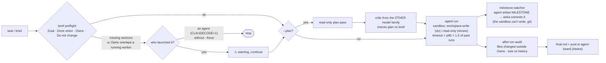
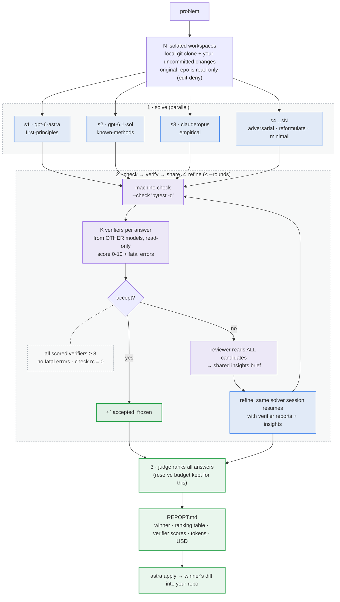

# astra

`astra` runs Codex (and optionally Claude) on a task **without side quests**: one focused run, a read-only review, or a
competition between several agents and models with cross-verification. Everything happens in an isolated run directory;
**nothing touches your repo until you `astra apply`.**

```text
astra do "<task>|@brief.md" [--plan] [-m MODEL] [-e EFFORT] [-t MIN] [--network] [--force]
astra review "<task>"
astra compete "<problem>|@file" [-n 6] [--models a,b,claude:opus] [--check CMD] [--budget MIN] [--board] [--bg]
astra status [run]   astra apply [run] [sN]   astra clean [run]   astra board [run]   astra usage [--since DATE]
```

## `astra do` and `astra review`



- **Brief preflight.** A good brief names the goal, what *done* means, which files the agent **owns**, and what it must **not change**. Missing sections are flagged. If two `do` runs in the same repo declare overlapping `Owns`, the second is warned (or stopped, if an agent launched it).
- **Plan gate (`--plan`).** A read-only planning pass, then a critic from the *other* model family (Codex ↔ Claude) checks the plan against the brief before any edit.
- **Budgets from history.** With no `-t`, the timeout is 1.5 × the 90th percentile of past runs of the same kind and model, so slow tasks aren't killed and stuck ones don't run forever.
- **Reporting.** Every run ends with a short note on the global board, so an interactive Claude or Codex chat can see what happened.

## `astra compete`



| Default | Value | Why |
|---|---|---|
| Solvers `-n` | 6 | enough diversity to cover all six starting angles |
| Models `--models` | `gpt-6-astra, gpt-6.1-sol, claude:opus` | solvers rotate through them; verifiers are drawn from the *others* |
| Solver effort `-e` | `ultra` | competition is for hard problems |
| Verifiers per answer | 2, effort `max` | independent, unanimous acceptance |
| Accept threshold | 8 / 10 | all scored verifiers must agree; an unscored verifier abstains rather than vetoes |
| Refine rounds | 2 | stall rule: the same check failure twice → stop refining that solver |
| Judge | `gpt-6-astra` | gets a reserved slice of `--budget` so it always runs |

**Starting angles.** Solvers that start from the same prompt walk the same path. Each solver gets one of:
*first-principles*, *known-methods*, *empirical*, *adversarial*, *reformulate*, *minimal*.

**Isolation.** Workspaces are `git clone --local` copies with your uncommitted diff and untracked files applied, then a
base commit, so each solver's `changes.diff` is exact. Codex solvers run in its OS sandbox; Claude solvers get Seatbelt
sandboxing (`failIfUnavailable`), no permission prompts, and an explicit `Edit` deny on your original repo.

**`--board`.** Solvers, verifiers and the reviewer share a *per-run* board. Solvers may post claims and evidence; only
verifiers and the reviewer can mark them verified or refuted. An `escalate` post rings `harness-alert` (max once per 10 min).

**`--budget MIN`** is a hard wall-clock stop. Solvers get ~40-60% of what's left, a reserve (≤ 15 min) is held for the judge,
and refinement is skipped when fewer than 5 minutes would remain.

### Run directory

```text
~/.codex/harness/runs/20261023-181035-compete-implement-semver-py/
├── PROBLEM.md  REPORT.md  INSIGHTS-1.md  state.json  log.txt
├── s1/ … s6/                 # isolated workspaces (removed by `astra clean`)
├── agents/s1/                # solve/ verify0-0/ refine1/ … transcripts, changes.diff
└── board/board.sqlite        # with --board
```

## Using it from a chat

Codex's `compete` skill (installed to `~/.codex/skills/compete`) turns "race a few agents on this" into the right
`astra compete … --bg` command, then reads progress with `astra status` and the run's `REPORT.md`.

## Models and cost

Change the default model lists in `harness/astra.py` (`CODEX_MODELS`) or per run with `--models`. Claude models are written
`claude:<model>`. `astra usage` totals tokens per model across runs and converts to USD with `harness/prices.json`
(API list prices you maintain; Codex runs billed to a ChatGPT plan are shown as API-equivalent).

> Verifier agreement is evidence, not proof. Check a winning result yourself before relying on it.
