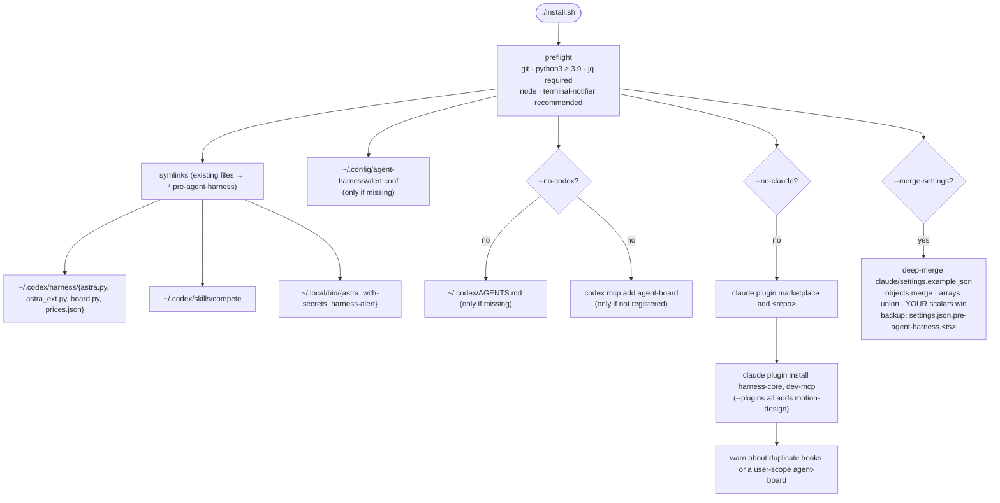

# Install

## Quick start

```bash
git clone https://github.com/<you>/agent-harness ~/agent-harness
cd ~/agent-harness
brew bundle              # macOS; on Linux: git jq python3 node, plus the claude and codex CLIs
./install.sh --dry-run   # prints every change, makes none
./install.sh
```

Clone **outside** iCloud Drive, Dropbox or OneDrive folders: sync clients and `.git` directories corrupt each other.

## What `install.sh` touches



Every step is idempotent: re-running prints `ok` for what's already in place. After `git pull`, re-run it to pick up new
links or plugins (`claude plugin marketplace update agent-harness` is run for you).

| Flag | Effect |
|---|---|
| `--dry-run` | print what would change |
| `--plugins all` · `--plugins harness-core,motion-design` | choose plugins (default `harness-core,dev-mcp`) |
| `--merge-settings` | merge `claude/settings.example.json` into `~/.claude/settings.json` |
| `--no-claude` · `--no-codex` | skip one side |
| `--uninstall` | remove only links that point into this repo, restore `*.pre-agent-harness` backups, unregister the board from Codex, uninstall the plugins and marketplace |

`CODEX_HOME` is respected. To test without touching your real setup:
`HOME=$(mktemp -d) CODEX_HOME=$HOME/.codex ./install.sh`.

## After installing

1. Make sure `~/.local/bin` is on your `PATH` (the installer warns if not).
2. Restart Claude Code and Codex.
3. `claude mcp list` should show `plugin:harness-core:agent-board ✔ Connected`; `codex mcp list` should show `agent-board`.
4. Store tokens for any token-backed MCP server: `with-secrets --set NAME` ([secrets](secrets.md)).
5. Ask Claude *"test my blocked alerts"*; you should hear and see it.
6. Personalize `~/.codex/AGENTS.md` and, if you like, `claude/settings.example.json` → `./install.sh --merge-settings`.

## Migrating an existing hand-rolled setup

If you (like the author) already had alert hooks in `~/.claude/settings.json` and a user-scope `agent-board` MCP server,
the plugin would duplicate them. The installer warns; fix it with:

```bash
claude mcp remove agent-board -s user                       # the plugin now provides it
jq 'del(.hooks)' ~/.claude/settings.json > /tmp/s && mv /tmp/s ~/.claude/settings.json   # if hooks were only the alerts
```

Existing files under `~/.codex/harness/` are moved to `*.pre-agent-harness` and replaced by links, and your run history in
`~/.codex/harness/runs/` is left exactly where it is.

## Contributing back

```bash
brew install pre-commit && pre-commit install   # gitleaks + shellcheck on every commit
python3 -m unittest discover -s harness         # astra tests
claude plugin validate . --strict && for p in plugins/*; do claude plugin validate "$p" --strict; done
```
