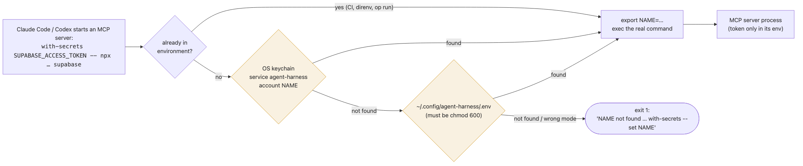
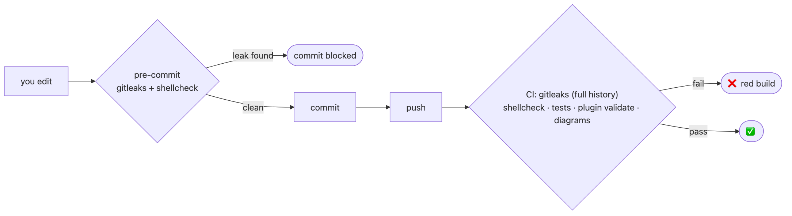

# Secrets

**Rule: a token lives in the OS keychain and exists in plaintext only inside the environment of the one process that needs it,
for as long as that process runs.** Never in a config file, never in git, never in a command-line argument.

## First choice: no token at all

Many services run a **hosted MCP server with OAuth** (for example `https://mcp.vercel.com`, `https://mcp.supabase.com/mcp`).
Add it by URL, then authorize once in the browser. Claude Code stores and refreshes the login itself, so there is no token to manage:

```bash
claude mcp add --transport http supabase https://mcp.supabase.com/mcp   # then /mcp → supabase → Authenticate
```

Use `with-secrets` only for **local (stdio) servers** that can't do OAuth and need an API key at launch.

## Why not just a `.env` file?

A `.env` is better than a token inlined in `~/.claude.json`, but it is still a plaintext file that backups, sync folders, editors
and agents can read. The common consensus (OWASP secrets-management guidance, the twelve-factor "config in the environment"
principle, and every major secret manager) is the same:

| Option | Encrypted at rest | Needs unlock | Shows up in `ps` | Ends up in backups / sync | Verdict |
|---|:-:|:-:|:-:|:-:|---|
| Token inline in MCP config / `~/.claude.json` | ❌ | ❌ | ✅ if passed as an argument | ✅ (including rolling `.claude.json` backups) | **avoid** |
| `.env` in the project | ❌ | ❌ | ❌ | ✅, and one `git add -A` from a leak | **avoid** |
| `.env` outside any repo, `chmod 600` | ❌ | ❌ | ❌ | maybe | acceptable fallback |
| **OS keychain via `with-secrets`** | ✅ | ✅ login keychain | ❌ | ❌ | **default** |
| 1Password / Vault / Doppler (`op run -- …`) | ✅ | ✅ | ❌ | ❌ | great; `with-secrets` honours a pre-set env |

## How `with-secrets` resolves a token

<picture>
  <source media="(prefers-color-scheme: dark)" srcset="diagrams/secrets-lookup-dark.png">
  
</picture>

<sub>Diagram source: <a href="diagrams/secrets-lookup.mmd"><code>secrets-lookup.mmd</code></a></sub>

`exec` replaces the wrapper with the real server, so there is no lingering parent process and the token appears in no
command line. On Linux the same lookup uses libsecret (`secret-tool`).

## Commands

```bash
with-secrets --set SUPABASE_ACCESS_TOKEN     # prompts; the value never touches argv or shell history
with-secrets --list                          # names only, never values
with-secrets --rm SUPABASE_ACCESS_TOKEN
with-secrets A B -- some-command --flag      # run anything with A and B injected
```

Register a token-backed MCP server:

```bash
# Claude Code (user scope; use -s local for one project)
claude mcp add supabase -s user -- with-secrets SUPABASE_ACCESS_TOKEN -- npx -y @supabase/mcp-server-supabase@latest
# Codex
codex mcp add supabase -- with-secrets SUPABASE_ACCESS_TOKEN -- npx -y @supabase/mcp-server-supabase@latest
```

## Rotation runbook

Rotate a token whenever it has been printed, pasted into a chat or transcript, committed, or stored in plaintext anywhere.
**Moving a leaked token into the keychain does not un-leak it.**

1. Create the replacement in the provider's dashboard (Supabase: Account → Access Tokens; Vercel: Account Settings → Tokens; GitHub: Settings → Developer settings).
2. `with-secrets --set NAME` and paste the new value.
3. Restart the client (Claude Code: `/mcp` → reconnect, or restart; Codex: restart) and check the server connects (`claude mcp list`).
4. Revoke the old token in the dashboard.
5. Sweep for leftovers: `for f in ~/.claude.json ~/.claude/backups ~/.codex/config.toml; do gitleaks dir "$f"; done`.

## Leak guards in this repo

<picture>
  <source media="(prefers-color-scheme: dark)" srcset="diagrams/leak-guards-dark.png">
  
</picture>

<sub>Diagram source: <a href="diagrams/leak-guards.mmd"><code>leak-guards.mmd</code></a></sub>

- `.gitignore` excludes `.env*` (except `.env.example`), keys and SQLite files before any content exists.
- `.gitleaks.toml` extends the default ruleset with Supabase (`sbp_…`) and Vercel (`vcp_…`) token shapes.
- `.env.example` lists variable **names** only.
- Enable the hook once per clone: `pre-commit install` (or `brew install pre-commit` first).
